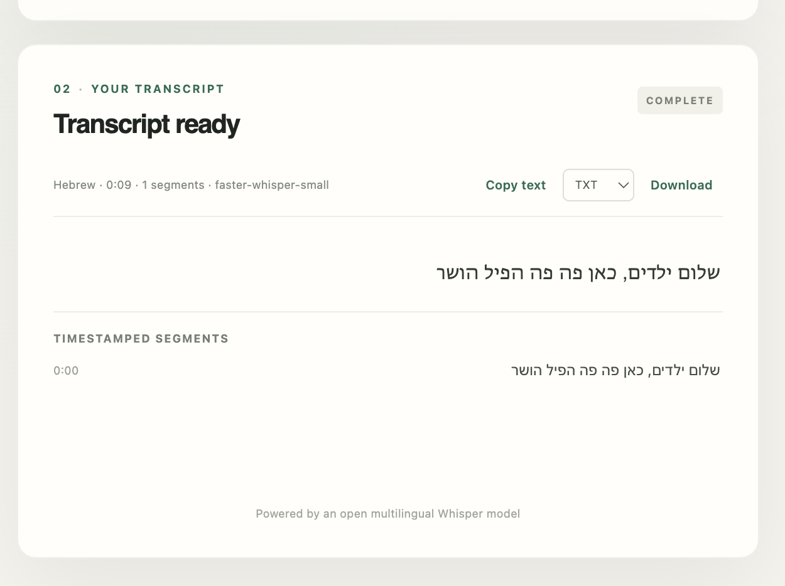

# Transcription Service

A local FastAPI application that transcribes uploaded audio or video using pinned multilingual
Whisper models from Hugging Face. It supports Hebrew, English, automatic language detection,
timestamped segments, and JSON/TXT/SRT/WebVTT downloads.

The service accepts uploads asynchronously: submit a file, receive a durable job ID, poll its
status, and download the result. Docker Compose runs the API, an independent inference worker,
PostgreSQL, and Redis on your machine. No hosted service or subscription is required.



Example result from a nine-second Hebrew recording using the default small model.

## Summary

Upload an audio or video file through the browser or API, follow its durable transcription job,
and copy or download the timestamped result. The service runs locally with Docker Compose and
uses open-source Whisper models from Hugging Face. It includes bounded uploads, retries,
restart recovery, isolated inference, and explicit retention policies. Setup instructions,
tests, architecture notes, and documented trade-offs are included for evaluation.

## Documentation

| Document | What it covers |
| --- | --- |
| [Execution Instructions](docs/execution-instructions.md) | Prerequisites, environment setup, Docker build/run, browser and API walkthroughs, local tests, real-model smoke tests, configuration, troubleshooting, and shutdown. |
| [Trade-offs & Assumptions](docs/trade-offs-and-assumptions.md) | Evaluation assumptions, design choices and alternatives, scope shortcuts, their consequences, validation boundaries, and conditions for revisiting them. |
| [Architecture Overview & Code Walkthrough](docs/service-architecture.html) | Runtime diagrams, one job traced through exact classes/methods, process and sandbox boundaries, data contracts, source map, and matching tests. Open the HTML file in a browser. |
| [Security Hardening](docs/security-hardening.md) | HTTP protections, private files, inference sandbox, platform requirements, and security verification. |
| [Code and Architecture Review](docs/code-review.md) | Resolved findings and historical verification evidence. |
| [Implementation Plan](docs/architecture-plan.html) | Completed implementation phases and historical milestones. Open the HTML file in a browser. |

For evaluation, read **Execution Instructions** first and **Trade-offs & Assumptions** second.
Those two guides describe the current submission; the implementation plan and review preserve
development history.

## Quick start

With Docker running and Docker Compose v2 installed, run these commands from the repository root:

```bash
docker compose config --quiet
docker compose up --build -d
docker compose ps
curl --fail http://localhost:8000/health/ready
```

Readiness can take a short time; retry the last command until it returns `{"status":"ready"}`.
Then open <http://localhost:8000/> for the browser interface or <http://localhost:8000/docs> for
interactive API documentation.

Readiness checks PostgreSQL, Redis, and the worker heartbeat. The first submitted job downloads
the selected model, so its inference takes longer. The default small model needs roughly 500 MB
of model downloads; the optional larger model requires several GB and additional RAM. See the
[complete setup and resource guidance](docs/execution-instructions.md#prerequisites).

To stop the stack while preserving its data:

```bash
docker compose down
```

## Test locally

With Python 3.12, `uv`, and Make available:

```bash
uv sync --frozen --all-groups
make check test package
```

The fast suite uses deterministic inference and job-infrastructure fakes, so it needs no running
database, Redis, or model download. Packaging may fetch the declared build backend. The most recent
local fast-suite run passed 78 tests with 78% coverage; this does not measure real transcription
accuracy or prove the Linux sandbox works on the evaluation machine. The
[testing guide](docs/execution-instructions.md#test-the-solution) separates fast checks, container
readiness, sandbox verification, and real-model inference.

## Supported workflow

- Upload WAV, MP3, M4A/AAC, FLAC, OGG, Opus, MP4, MOV, WebM, or MKV.
- Select a language or automatic detection, speech/music mode, and faster/larger model profile.
- Receive `202 Accepted` with origin-relative status and result URLs.
- Poll through `queued` and `running` to `succeeded`, `failed`, or `expired`.
- Download a successful result as JSON, TXT, SRT, or VTT.
- Resume browser polling after reload; reuse matching submissions through idempotency keys and
  content hashing.

The worker normalizes the first audio stream to 16 kHz mono PCM, processes resumable chunks, and
runs inference in a child process with a hard deadline. PostgreSQL owns job state and results;
Redis delivers job IDs; named Docker volumes preserve data across container replacement.

## Trade-offs & Assumptions

This submission targets one trusted local user, one Docker host, CPU inference, and bounded
recordings (100 MiB / 15 minutes by default). It prioritizes durable asynchronous processing,
reproducible dependencies, and enforceable execution limits.

Explicit scope shortcuts include no account/authentication layer, no distributed user quotas, no
multi-host media storage, no warm model pool, and no transcription-accuracy benchmark. Only the
first audio stream is selected, normalized PCM is buffered in memory, and completed chunk text is
joined without cross-chunk context reconciliation. These choices and their operational consequences
are documented in [Trade-offs & Assumptions](docs/trade-offs-and-assumptions.md), including the
[scope shortcuts and deferred work](docs/trade-offs-and-assumptions.md#scope-shortcuts-and-deferred-work).

Singing and mixed-language accuracy remain model-dependent. A larger model is an option for
comparison, not a quality guarantee. Public or multi-user deployment requires additional identity,
authorization, TLS, tenant-scoped caching, and shared quota controls.

Update the relevant guide in the same change whenever a runtime instruction, assumption, or design
decision changes.

